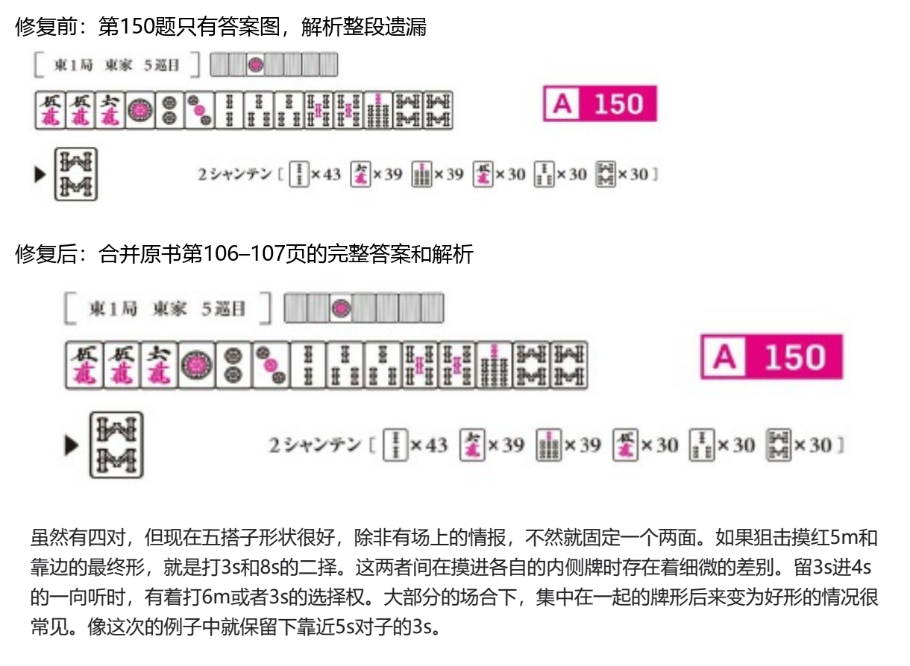

# 何切601题全量校验与修复

校验日期：2026-10-23。版本：0.4.8。

本次以用户提供的《何切300》《何切301》原始 PDF 为依据，核对全部601道题面和答案，没有用 AI 补写或猜测原书解析。

## 发现的问题

| 检查项 | 结果 |
| --- | --- |
| 题号及题答对应 | 1202个 Q/A 标记全部核对，无错配 |
| 题号核对方式 | 1176个直接 OCR 匹配，26个看图复核 |
| 旧图遗漏解析文字 | 110题，其中58题整段中文解析缺失 |
| 原书跨页答案 | 54题，已完整合并 |
| 旧图混入相邻内容残字 | 63题 |
| 旧图裁掉部分答案题头 | 8题 |
| 存在上述答案问题的题数（去重） | 163题 |
| 题面图片 | 600张确认完整并保留；H300-286去除多带入的边角内容 |
| 原书自身没有解析的题目 | 本次601题均找到原书文字解析 |

以上问题存在重叠，不能把各行直接相加。这里的“残字”包含裁切边界穿过上一段文字、只混入半行字形的情况。

第150题对应 H300-150：答案图在原书 PDF 第106页，163个非空白文字字符的中文解析接在第107页。旧程序跳过没有 Q/A 标记的第107页，并裁掉约7.51pt的答案题头；本次都已修复。

## 校验方法

1. 扫描两份 PDF 的所有正文页，提取图像对象、正文文字坐标、章节标题和 Q/A 标记。
2. 独立识别每个标记上的实际题号；对不确定的26个标记看图复核。题面与答案保持一一对应，原有全局题号、书内题号和起始页码不变。
3. 答案从原始插图的上边界开始，保留之后的解析与附图；解析跨页时继续提取下一页，直到下一题或新章节/理论专栏。不会把第150题后面的理论专栏也拼进答案。
4. 对601道答案逐一检查文字和附图边界；一旦边界穿过文字或附图就中止导出，不静默生成半行解析。单独检查全部601道题面在旧裁切区域之外是否有内容遗漏或混入。
5. 复核第150题、8处题头裁切、跨页、长解析和带附图等异常样例的最终渲染。完整对照结果包含全部601题，程序覆盖检查与人工看图复核的范围分别记录。
6. 发布前逐一验证601道答案的图片摘要、尺寸和 PNG 完整性，同时验证所有题面可正常打开。

## 修复内容

- 全部答案改为从 PDF 重新生成的 PNG，保留中文矢量文字的清晰度。
- 原书插图的固有清晰度仍受原始素材限制，不通过生成式修复改动画牌信息。
- 高清缓存按源图片内容摘要区分。替换解析图后，即使时间戳相同，也不会继续发送旧缓存。
- 保持题号和练习记录，已有随机进度、当前题、定时出题及其他功能无需重设。

## 追溯文件

- [总结果](../data/audit_summary.json)
- [逐题答案原文、原页裁切区域和图片摘要](../data/audit_manifest.json)
- [全部题面的边界核对结果](../data/question_audit.json)
- [1202个题号的识别/复核记录](../data/label_verification.json)
- [可直接查看的题面与完整解析](../data/validation_report.html)

原始文件 SHA-256：

- 何切300：`3e456dce7dd3de292e897c83ecf077a881b6aa402137e428181981de744bbab8`
- 何切301：`baeaa3aeb703805ca3a45fdf97496eb735a4a726618bf7c8d89e423163df41fc`

## 重新构建

构建工具位于 `tools/`，仅构建时需要 numpy、Pillow、pdfplumber、pypdfium2；机器人运行时不新增 PDF/OCR 依赖。原始 PDF 不随插件分发。

先用 `scan_dataset.py --source-dir 原书目录 --output-dir 扫描目录` 生成页面清单和题号小图。Windows 可用 `verify_labels_windows.ps1 -Directory 扫描目录` 识别题号，不确定项需看图复核后写入题号验证记录。

然后执行 `build_dataset.py --source-dir 原书目录 --output-dir 新题库目录 --scan 扫描目录/source-scan.json --verified-labels 题号验证记录.json --legacy-dir 旧题库目录`。不要覆盖正在使用的题库作为旧图输入；先在新目录生成并校验，再发布。
